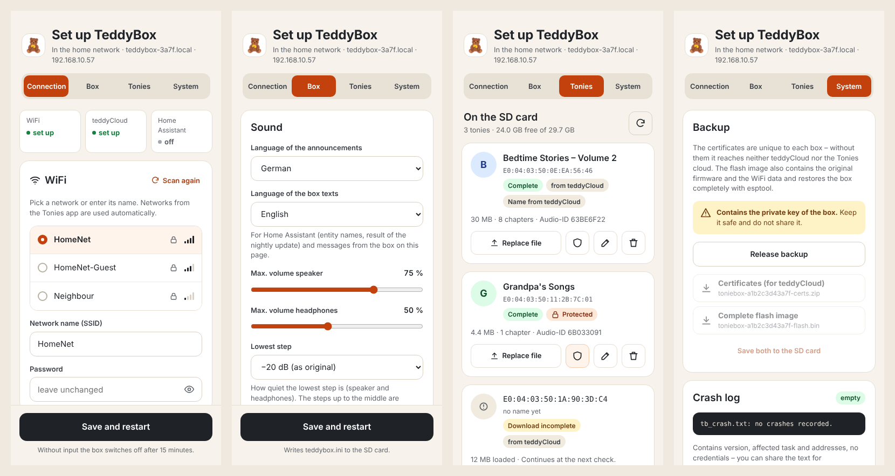
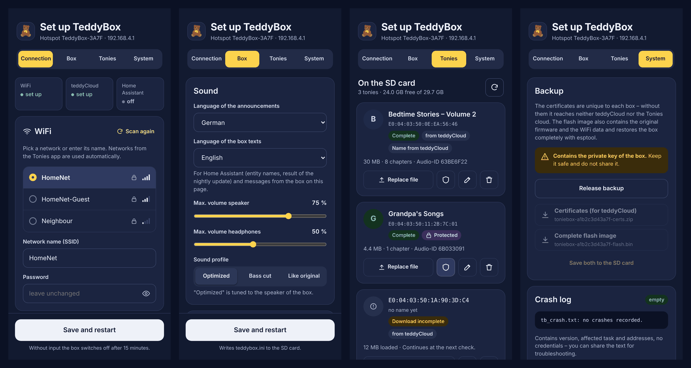

# TeddyBox

Custom firmware for the ESP32-S3 based Toniebox, for use with
[teddyCloud](https://github.com/toniebox-reverse-engineering/teddycloud).
It runs in the OTA slots next to the original Boxine firmware (`toniebox-esp32-eu`),
which is never touched and can be booted again at any time: box upside down,
hold both ears for 20 seconds, let go (or a button on the setup page).

Built with ESP-IDF 5.5 and ESP-ADF 2.8. Tested on one box (ESP32-S3, 8 MB
flash, LIS3DH accelerometer) against teddyCloud.

## TeddyBox compared with the original firmware

| | Original firmware (`toniebox-esp32-eu` v5.235) | TeddyBox |
|---|---|---|
| Content source | Boxine cloud, or teddyCloud with a patched CA | teddyCloud only; Boxine cloud as optional fallback (`boxine_fallback`, off) |
| Talks to Boxine | yes: content, time, claim, log upload (`/v1/log`), firmware checks (`/v1/ota`), live log (`rtnl.bxcl.de`) | no (teddyCloud may, if its own cloud access is on) |
| Telemetry, logs to the cloud | yes | none |
| New tonie, never played before | loaded from the Boxine cloud | loaded through teddyCloud, which needs cloud access for it; a hint sound if that fails |
| Tonie placed is reported (claim) | always | off by default (`claim = 1`) |
| Freshness check (new episodes, changed content) | yes | yes, same protocol |
| Downloads | to `.tmp`, renamed when complete | the same; plus SHA-1 check of every file against its header, damaged files are downloaded again |
| Nightly content update | — | optional, at a set hour, on the charger or from 30 % battery (adjustable) |
| Opus decoder | libopus, CELT only | the same (libopus 1.5.2, CELT only, fixed point), ESP-ADF as fallback |
| SD card hangs during playback | own SD task with double buffers | own read-ahead task, 32 KB (about 2.7 s) |
| Setup | Tonies app, hotspot `Toniebox-XXXX` | own setup page, hotspot `TeddyBox-XXXX` (big ear while switching on); WiFi of the original is used as is |
| Settings | Tonies app / cloud | setup page, `teddybox.ini` on the SD card, Home Assistant; max volume (speaker/headphones), LED and slap also from teddyCloud |
| Live events (RTNL: tonie, playback, volume, ears, slap, tilt, charger) | to Boxine (`rtnl.bxcl.de`), or to teddyCloud with a patched CA | to teddyCloud only (`rtnl`, on) |
| Home Assistant | — (only what teddyCloud derives from the box) | MQTT discovery: playback, tonie, chapters, progress, volume, battery, settings, diagnostics, buttons |
| Speaker sound | flat | three profiles in the DAC's own filters: flat, low cut, tuned (measured, default) |
| Volume, ears, slap, tilt, headphones, LEDs | yes | yes (volume steps and slap configuration taken from the original) |
| System sounds | yes | the same sounds, read from the box's assets |
| Firmware updates | from Boxine, automatically | online from GitHub releases or uploaded, on the setup page, A/B with rollback |
| Back to the other firmware | — | upside down, both ears 20 s, let go; setup page; Home Assistant |
| Gestures | ears, slap, tilt; upside down both ears 10 s: restart | the same, plus as Hackiebox CFW: both ears briefly = off, upside-down slap = start over; see "Gestures" |
| Sleep timer | — (Toniebox 2 / app only) | small ear held 2 s (30 min) or Home Assistant; quieter at the end, then off |
| Certificate / flash backup | — | on the setup page (needs a press on the box) |
| Own content without a server | — | TAF upload per tonie on the setup page, protected from updates |
| Tonie names | in the app | from teddyCloud or own names: setup page and Home Assistant |
| Crash diagnostics | crash logs to Boxine | `tb_crash.txt` on the SD card, shown on the setup page; task watchdog |
| MMA8451 accelerometer (some boxes) | yes | no, LIS3DH only |
| Tonies app pairing | yes | no |

## What works

- Playback of tonie content (TAF files) from the SD card, seeking, chapters
- NFC (TRF7962A), ears for volume, headphone detection, LEDs, accelerometer
  (slap and tilt for chapters)
- **WiFi from the original firmware**: networks stored by the Tonies app
  (NVS `TB_WIFI`, `SSID0..6`/`PW0..6`) are used directly, newest first.
  WPS push button as fallback, credentials are stored in the same format.
- **System sounds from the box itself**: `fw/sfx.bin` of the assets partition
  holds all 25 voice lines (startup jingle, low battery, ...). On boot they
  are copied once to `/CONTENT/<lang>/<id>` on the SD card. Files that
  already exist are never overwritten, so custom sounds can be placed there.
- **Language and battery thresholds from the original settings**
  (NVS `TB_SETTINGS`: `LANG_ID`/`FAC_LANG_ID`, `BAT_CRITICAL`, `BAT_LOW_LEVEL_D/U`)
- **Battery monitoring** (GPIO9, 100k/33k divider) and charger detection
  (GPIO8, 100k/100k): warning sound when low (never interrupts a story),
  announcement and power off when critical
- Content download from teddyCloud (`/v2/content`, resume via `Range`),
  tag password read from the tag and sent as `Authorization: BD <hex>`;
  playback starts after a few blocks while the rest downloads
- **Freshness check**, **nightly update**, **Home Assistant**, **firmware
  updates**: see below

## Setup page

On the first boot (no `teddybox.ini` on the SD card yet), when the big ear
is held for 3 seconds while switching on, or with the Home Assistant button
"Start setup", the box says the installation announcement and blinks
blue/green.

- **In the home network** (WiFi already set up): the box first connects to
  the stored network (up to 20 s). The page is then at
  `http://teddybox-xxxx.local/` (mDNS; `xxxx` as in the box's host name in
  the router) or at the box's IP; the device page in Home Assistant links to
  it ("Visit", it answers only in setup mode). Phone or PC stay in the home
  network and keep their internet.
- **Hotspot as the fallback** (no WiFi set up, or not reachable): WiFi
  `TeddyBox-XXXX` (no password, only while setup runs). Phones show the
  setup page automatically, otherwise open `http://192.168.4.1/`.

The page has no password: while setup runs, anyone in the home network (or
in range of the hotspot) can change the settings. Setup mode needs the ear
at the box or the Home Assistant button, and ends after 15 minutes without
use. Downloading the backup always needs the small ear at the box.

Four tabs:



<details><summary>Dark mode (follows the phone or PC setting)</summary>



</details>

- **Verbindung**: WiFi (with network scan), teddyCloud (address, port, CA
  upload as DER or PEM), Home Assistant (MQTT)
- **Box**: volume, language, power off time, speaker sound, LED, slap and
  tilt, gestures, nightly update, freshness check, and (sections) decoder,
  CPU clock, download speed while playing, read-ahead, RTNL
- **Tonies**: the tonie files on the SD card, uploading TAF files or converting audio files to a tonie, see
  below
- **System**: backup, crash log (see "Crash dumps"), firmware update,
  start the original firmware

The page is in German when the browser prefers German, otherwise in
English. Texts that come from the box itself (error messages, Home
Assistant names, the nightly update result) follow `text_language`
(English by default, see "Configuration").

Saving (tabs Verbindung and Box) writes `teddybox.ini`, stores the WiFi in
the original firmware's format and restarts. Unused for 15 minutes, the box
switches off. Cloud, MQTT and NFC do not run in setup mode.

### Tonies (setup page)

Lists every tonie on the SD card with its state (complete, incomplete
download, damaged, new version waiting, stream), size, chapters and audio
id, and whether the file came from teddyCloud or was uploaded. For each:

- **Datei hochladen**: a finished TAF file (from teddyCloud, TonieToolbox,
  teddy …) for this tonie. The box checks the header, that the length fits
  and the SHA-1 of the audio data before it replaces anything; a damaged or
  incomplete file is refused and the old one stays.
- **Vor teddyCloud schützen / Schutz aufheben**: a protected file
  (`<file>.own` next to it; every upload is protected) is not reported in
  the freshness check and not touched by the nightly update, so teddyCloud
  never replaces it.
- **Löschen**: the file and its leftovers (`.tmp`, `.old`, `.bad`).
- **Name geben / ändern**: an own name shown instead of the UID (named
  tonies first, sorted by name). Kept in `tb_alias.txt` on the SD card
  (`UID=name` per line), also after deleting the file. Without an own name
  the name from teddyCloud is shown (badge "Name aus teddyCloud").

Names from teddyCloud: while teddyCloud is the backend in use, the box asks
its web interface (`http://<cloud_host>:<tc_web_port>/api/getTagInfo`,
plain HTTP, port 80 by default, field "Web-Port" on the setup page) for
series and episode of each tonie from teddyCloud's `tonies.json` (or
`tonies.custom.json`): the tonie on the box first, then the others on the
card one every 2 s, each once per start (while a tonie downloads and
plays, memory is too short for the request: the box then asks again 30 s
later). They are kept in `tb_names.txt`
and also go to Home Assistant as "Tonie-Name". If teddyCloud's web
interface needs a login, no names are fetched (log line once). Only the
default content folder of teddyCloud is asked (no per-box overlay). QEMU
test `tests/qemu/mkqnames.sh run`.

A tonie that is not on the card yet: pick it from "zuletzt aufgelegt" (the
last 8 tags placed on the box, kept in NVS) or type its UID. A large tonie
can take a few minutes over the hotspot. QEMU test
`tests/qemu/mkqtonies.sh run`.

**Audio files to a tonie** ("Oder: Audiodateien umwandeln"): choose MP3,
M4A, WAV, OGG, FLAC … (whatever the browser can decode), each file becomes
a chapter (sorted by name, order can be changed). The conversion runs in
the browser, the box only gets the finished TAF through the normal upload
(checked and protected like any upload). Works in hotspot mode too, no
internet needed:

- The browser decodes each file (Web Audio, resampled to 48 kHz) and hands
  it to a Web Worker (`main/www/taf_worker.js`) with libopus as WebAssembly
  (`main/www/opusenc.js` from [opus-recorder](https://github.com/chris-rudmin/opus-recorder)
  8.0.5, MIT; libopus 1.3.1, BSD). WebCodecs or `crypto.subtle` would need
  HTTPS, the setup page is plain HTTP; SHA-1 is computed in the worker.
- Opus like original tonies: CELT only (the box decodes nothing else),
  60 ms frames, 48 kHz stereo, 96 kbit/s VBR.
- TAF layout: 4 KB protobuf header (SHA-1, length, audio id = current time,
  chapter pages), OpusHead and OpusTags filling the first 4 KB of the
  stream, then Ogg pages of exactly 4096 bytes with whole packets (the gap
  filled with Opus padding in the packets), each chapter on a new page.
- Served from flash gzip compressed (encoder 180 KB, worker 5 KB; the setup
  page itself is now gzip compressed too, 23 KB instead of 80 KB), cached
  by the browser per firmware version. The page keeps the box awake during
  long conversions.
- Speed: about 50 times real time on a PC (one hour in about a minute),
  slower on phones. A long single file is decoded completely into memory
  (about 1.4 GB for 60 minutes): on phones better in chapters.
- Tests: `tests/web/run.sh` (encodes test signals in Chrome, checks the
  layout, decodes with the box's own CELT decoder and Ogg demuxer, checks
  frequencies and levels, also short chapters and 5 minutes in one), and
  `tests/qemu/mkqtonies.sh run` (box serves encoder and worker, accepts a
  TAF made in the browser).

### Backup (setup page)

The setup page offers a backup of what is unique to the box:

- `toniebox-<mac>-certs.zip`: `ca.der`, `client.der`, `private.der` (the
  names teddyCloud expects)
- `toniebox-<mac>-flash.bin`: the whole flash (bootloader, original
  firmware, NVS with WiFi data, certificates); restore with
  `esptool.py --chip esp32s3 write_flash 0x0 toniebox-<mac>-flash.bin`
- optionally both onto the SD card (`teddybox_backup/<mac>/`)

The setup hotspot is open, so the backup is only released after the small
ear is pressed on the box (60 s to press it, then 10 minutes valid). The
files contain the private key of the box.

## Configuration: `teddybox.ini` on the SD card

Written by the setup page; all keys are optional.

| Key | Default | |
|---|---|---|
| `cloud_host`, `cloud_port` | empty, 443 | teddyCloud; the cloud stays off while `cloud_host` is empty |
| `tc_web_port` | 80 | teddyCloud's web interface (plain HTTP) for the tonie names, 0 = do not ask |
| `ca_path` | `/spiflash/cert/ca.der` | CA of teddyCloud (`certs/server/ca.der`); the CA in flash only works if it was replaced by the teddyCloud patch, otherwise put it on the SD card |
| `cloud_enabled` | on with a host | `0` forces the cloud off |
| `boxine_fallback`, `boxine_host` | 0, `prod.de.tbs.toys` | see below |
| `user_agent_original` | 0 | see below |
| `mqtt_host`, `mqtt_port`, `mqtt_user`, `mqtt_pass` | empty, 1883 | Home Assistant; off while `mqtt_host` is empty |
| `mqtt_topic`, `ha_discovery_prefix` | `teddybox/<mac>`, `homeassistant` | |
| `lang_id` | from NVS | system sounds: 0=EN-GB 1=DE 2=EN-US 3=FR |
| `volume_max`, `volume_default` | 100, 50 | percent |
| `volume_max_hdp` | 100 | percent, with headphones plugged in |
| `tc_box_settings` | 1 | take over box settings changed in teddyCloud, see below |
| `idle_timeout` | 60 | seconds until power off |
| `speaker_eq` | `full` | `off`, `lowcut`, `full`, see Audio |
| `led_brightness` | 3 | 0 (off) to 3 |
| `slap`, `slap_reverse` | 3, 0 | slap on the side for next/previous chapter: 0 off, 1 firm to 5 light |
| `tilt` | 3 | tilt for chapter/seek: 0 off, 1 far to 5 a little |
| `update_hour` | 3 | nightly update, -1 off |
| `update_battery` | 30 | nightly update without the charger from this battery charge (10–100 %), -1 only on the charger |
| `freshness_interval` | 60 | minutes between freshness checks (15-720), see below |
| `timezone` | `CET-1CEST,M3.5.0,M10.5.0/3` | POSIX TZ |
| `claim` | 0 | report placed tonies to teddyCloud |
| `decoder` | `celt` | `celt` or `adf` |
| `cpu_mhz` | 160 | 160 or 240 (`decoder = adf` always uses 240) |
| `download_playing` | 0 | KiB/s while a tonie plays, 0 = unlimited |
| `readahead` | 1 | 0 only for diagnosis |
| `ears_poweroff` | 1 | both ears pressed briefly switch the box off |
| `text_language` | en | language of texts from the box: Home Assistant entity names and values, nightly update result, error messages on the setup page; `en` or `de` (setup page: Box tab) |
| `rtnl` | 1 | box events to teddyCloud, see below |
| `mem_log` | 1 | memory lines in the serial log |

The cloud is off by default on purpose: the box certificate would otherwise
be used against the Boxine cloud by a non-original firmware.

### Optional: Boxine fallback and original user agent

Both are off by default and can be switched on in the setup page
("Erweitert") or in `teddybox.ini`.

- With `boxine_fallback`, the box tries teddyCloud first and uses the Boxine
  cloud only if teddyCloud does not answer; every 5 minutes it checks whether
  teddyCloud is back. Boxine connections use the original CA from the assets
  partition, send SNI and verify the server name, like the original firmware.
- teddyCloud passes the box's user agent on to Boxine. Without
  `user_agent_original`, Boxine therefore sees `toniebox-esp32-teddybox/...`
  whenever teddyCloud fetches content for TeddyBox.
- The user agent is not the only difference: TLS handshake (mbedTLS 3.6 from
  IDF 5.5 instead of the original's IDF 5.0, TLS 1.2 only) and behaviour (no
  log upload, no firmware checks) differ as well. If Boxine blocks the box
  certificate, the Boxine cloud stops working for the original firmware and
  teddyCloud too.

## teddyCloud

TeddyBox uses the same protocol as the original firmware: `GET /v1/time`,
`GET /v2/content/<rUID>` with `Authorization: BD <tag memory>` and `Range`
for resuming. teddyCloud identifies it as an ESP32 box by the user agent
`toniebox-esp32-teddybox/<version>`. Requirements:

- `cloud_host` set to teddyCloud
- teddyCloud's CA (`certs/server/ca.der`) reachable via `ca_path`
- the box certificates known to teddyCloud (`certs/client/<mac>/`), as for
  the original firmware

A tonie that teddyCloud does not have yet can only be loaded if teddyCloud
may fetch it from the Boxine cloud (`cloud.enabled` and content v2 in
teddyCloud). Otherwise teddyCloud closes the connection without an answer;
the box logs that and plays the original's network error sound. Placing the
tonie again loads it once teddyCloud has it.

### Freshness check

After boot (as soon as teddyCloud is reachable), every hour
(`freshness_interval`, 15 to 720 minutes) and after a tonie was removed (at
most every 15 minutes), always only while nothing plays, the box
sends UID and `audio_id` of every tonie on the SD card to
`POST /v1/freshness-check`. teddyCloud answers with the tonies that have new
content: a newer version in its library, a newer version in the Boxine
cloud (if cloud access is enabled in teddyCloud) or live content. Those
files are renamed to `<file>.old`; the next time the tonie is placed (or in
the nightly update) the new version is downloaded. If that fails, the `.old`
version is played instead. `.old` files are removed once the new version is
complete. A tonie that is playing during the check is handled next time.
Up to 128 tonies per check.

The answer also carries the box settings from teddyCloud (*Settings →
Toniebox*, per box in the overlay; with "override cloud" off the values from
the Tonie app). TeddyBox takes over the ones that **changed there** since
the last check, so a setting changed on the box itself (setup page, INI,
Home Assistant) stays until it is changed in teddyCloud again. The first
check after the update only stores the values. `tc_box_settings = 0` ignores
them.

| teddyCloud | TeddyBox |
|---|---|
| max volume speaker / headphones 0–3 | `volume_max` / `volume_max_hdp` 25 / 50 / 75 / 100 % |
| LED on / off / dimmed | `led_brightness` 3 / 0 / 1 |
| slap off / on | `slap` 0 / the previous level (3 if it was off) |
| slap direction "back on the left" | `slap_reverse` |

Log: `TCSET: Applying <n> box setting(s) changed in teddyCloud`. QEMU test
`tests/qemu/mkqtcset.sh run`.

### Claim (tonie placed)

Like the original box, TeddyBox can report a placed tonie to teddyCloud with
`GET /v1/claim/<rUID>` and the tonie's token (5 s after placing). teddyCloud
shows it as the box's last tonie and marks it as claimed. It is never sent
to the Boxine fallback; but teddyCloud itself forwards claims to the Boxine
cloud if its cloud access and "Forward claim" are enabled, so every placed
tonie would reach Boxine. Therefore it is off by default; `claim = 1` turns
it on. Home Assistant shows the current tonie anyway.

### Live events (RTNL)

Like the original firmware, TeddyBox sends box events over RTNL (4 byte
length + protobuf `TonieRtnlRPC`, on teddyCloud's API port with the box
certificate). teddyCloud shows them live in its web interface and passes
them to its own MQTT / Home Assistant integration; it does not forward them
to Boxine. Sent: tonie placed and removed, audio id, playback starting /
started / stopped, volume (level and dB as the original), ears, slap
(knock), tilt chapter, charger on/off, and the firmware version
(`TeddyBox <version>`) after connecting. Only while teddyCloud is the
backend in use, never to the Boxine fallback; events while it is not
reachable are dropped. The connection is closed after a minute without
events (it costs RAM). `rtnl = 0` switches it off.

teddyCloud reads the tonie UID with a sign-extension bug: a UID whose lower
half is `0x80000000` or more shows up with `FFFFFFFF` in front in its event
view (the same happens with the original box).

QEMU test `tests/qemu/mkqrtnl.sh run` (checks teddyCloud's `/api/sse`).

## Downloads

- As in the original firmware, a download is written to `<file>.tmp` and only
  renamed to the tonie file when it is complete and valid, so a partial
  download never looks like a tonie. An interrupted download continues from
  the `.tmp` the next time. Tested in QEMU against teddyCloud
  (`tests/qemu/qemu_dl_test.c`).
- Full speed also while a tonie plays (about 300 KiB/s; the decoder then
  needs about 40 % of one core at 160 MHz). `download_playing = <KiB/s>`
  limits it. With `decoder = adf` at most 96 KiB/s.
- **Hash check** (`main/taf_verify.c`): after each download and once per start
  for every tonie played, a background task compares the SHA-1 of the audio
  data with the one in the TAF header (`Verify: Audio hash OK` / `MISMATCH`,
  about 30 s for 30 MB). A damaged file is renamed to `<file>.bad` (when its
  playback ends) and downloaded again next time
  (`tests/qemu/qemu_verify_test.c`).
- A failed download (teddyCloud unreachable or without the content) plays
  the original's network error sound. A tonie that needs a download first
  waits up to 30 s for WiFi and teddyCloud (right after power on they need
  a few seconds) instead of failing at once; taken off meanwhile, nothing
  happens.
- The start jingle plays to the end, as on the original: a tonie on the box
  at power on (or placed during the jingle) starts after it, at most 10 s
  later.

## Nightly update

Once a day at `update_hour` (local time, `timezone`; default 3 o'clock plus
0-29 minutes) the box wakes from deep sleep by timer, without sound or LED
and without reading NFC. It waits for the freshness check against teddyCloud
and then downloads every tonie that has a new version (`<file>.old`) or an
unfinished download, one after another.

- On the charger always, on battery from `update_battery` (default 30 %,
  resting voltage; setup page: Box tab, "Without the charger"), or with
  `update_battery = -1` only on the charger.
- A pressed ear stops it and starts the box normally; a download without
  progress for 2 minutes, low battery or 45 minutes in total stop it, the
  rest continues the next night or when the tonie is placed.
- Downloading without the tonie on the box needs its token. It is stored when
  a tonie is placed (`/sdcard/TOKENS/<dir>/<file>`, same names as in
  `CONTENT`, 32 bytes, only written when it changes). Tonies not placed since
  this version are skipped. **The tokens give access to the tonie's content in
  the cloud: whoever has the SD card has them.** Delete the `TOKENS` folder to
  remove them.
- Planned when the box goes to sleep, at least one hour after the last run.
  Changing `update_hour` (setup page) plans it again for the new hour.
- Needs a valid clock (set from teddyCloud on every connection; kept in deep
  sleep, lost when the battery is removed: then the next normal start plans
  it again).
- The clock in deep sleep runs on the internal RC oscillator and drifts
  (seen: about 1 %, 9 minutes fast after 14 hours). At the first time sync
  after a sleep of 2 hours or more the box measures the drift
  (`Maint: Clock: … drift <n> ppm`), averages it with the previous value and
  keeps it in NVS. With it the clock is corrected at every wake and the
  sleep timer is lengthened or shortened, so the run starts on time and its
  result carries the right time. Values beyond 5 % are ignored.
- The result (also "skipped (battery x %)") is kept in NVS, so it survives
  power loss and flashing. After a run the box waits up to 30 s for MQTT, so
  Home Assistant gets it right away (diagnostic sensor "Last nightly
  update"). Every start logs
  `Maint: Nightly update: last <date>: <result>, next planned <date>`.
- The run notes the step it is in (`Maint: Step: …`). If it does not end
  normally (hangs, crash, power loss), the next start reports it as its
  result: "interrupted at: <step>" or "<result>, then: <step>". If the
  run is still going 50 minutes after it started (45 minutes plus 5 for
  sending the result), a guard notes "hung at: <step>" and switches the box
  off, silently, as after a normal run.

## teddyCloud plugin

`teddycloud-plugin/teddybox/` is a page for teddyCloud's web interface: which
boxes run TeddyBox and in which version (with a hint when a newer release
exists), the link to each box's setup page, audio files to a tonie in one
step (encoded by teddyCloud), and live box events. Copy the folder into
teddyCloud's `plugins` folder; details in its README.

## Home Assistant

With `mqtt_host` set, the box registers itself via MQTT discovery as device
"TeddyBox" (`<id>` = `teddybox_<mac>`, 35 entities):

| Entities | |
|---|---|
| Status, Tonie, Kapitel, Kapitel gesamt | playing / idle, UID of the current tonie, chapter |
| Tonie-Name | name of the current tonie: own name from the setup page, else teddyCloud's ("series – episode"), else the UID |
| Fortschritt, Kapitel-Fortschritt, Gespielt, Gesamtdauer | progress in % and minutes (from the Ogg granule positions), at most every 10 s |
| Download | % of a running download |
| Lautstärke | number, limited by `volume_max` |
| Akku (geschätzt), Akkuspannung, Lädt, Akku schwach | charge estimated from the voltage (NiMH curve, amplifier load added back, unknown while charging) |
| Kopfhörer, WLAN-Signal | |
| LED-Helligkeit, Klapsen, Klapsen umgekehrt, Kippen, Lautsprecher-Klang | settings, applied at once and saved to the INI |
| Stopp, Nächstes/Vorheriges Kapitel, Ausschalten | buttons |
| Original-Firmware starten | button, disabled by default in Home Assistant |
| Start setup / Einrichtung starten | button: restarts into setup mode (in the home network, see "Setup page") |
| Schlaf-Timer | number in minutes (0 off, up to 240), shows the minutes left; see "Sleep timer" |
| Diagnostics | free heap (now and minimum), start time, reason of the last start, firmware slot, last nightly update |

Topics: `teddybox/<mac>/state` and `/diag` (JSON),
`teddybox/<mac>/availability` (`online`/`offline`, also as last will) and
`teddybox/<mac>/cmd/<command>`. Commands that come with the retain flag
(stored on the broker) are ignored and deleted there: they would be repeated
at every start and override the settings. The box powers off when idle
(`idle_timeout`), Home Assistant then shows it as unavailable.

## Gestures

Aligned with the original firmware and the Hackiebox CFW, so parents with
several boxes use the same gestures:

| Gesture | Effect | as |
|---|---|---|
| ear briefly | volume up / down | original |
| slap on the side | next / previous chapter | original |
| tilt | wind forward / back | original |
| both ears pressed, let go within 2 s | power off (tonie position kept); `ears_poweroff = 0` or setup page switches it off | Hackiebox CFW |
| slap upside down, either side | start the tonie over | Hackiebox CFW (original: one chapter) |
| upside down, both ears 10 s, let go | restart (beep at 10 s) | original |
| upside down, both ears 20 s, let go | original firmware (LED blinks blue, beep) | TeddyBox only |
| small ear alone 2 s | sleep timer 30 min on / off | TeddyBox only |
| big ear while switching on | setup page | TeddyBox only |

The long gestures act when the ears are **let go**, not while held: the
firmware that starts next must not see both ears held upside down (in the
original that is restart, on the charger factory reset). Held 30 s, or the
box turned upright while holding: nothing. Without a working accelerometer
the long gestures also work upright. The original firmware's "both ears
5 s" (WiFi setup / offline mode) does nothing in TeddyBox. The gestures with both
ears run in their own small task, so restart and the switch to the original
firmware also work when the main loop hangs.

## Sleep timer

Hold the **small ear alone for 2 seconds**: the sleep timer starts with 30
minutes (long high beep); the volume step of the press is taken back. The
same again switches it off (long low beep). From Home Assistant the number
"Schlaf-Timer" sets any time from 5 to 240 minutes (0 = off) and shows the
minutes left. Over the last third of the time (1 to 10 minutes) the volume
goes down to nothing, then the box stops and switches off. The volume
itself stays as it was; the ears and Home Assistant still change it during
the fade. The timer is not kept when the box switches off before.

## Audio

Output and volume work as in the original firmware (driver `CO3100.c`,
read from the flash dump):

- speaker: both channels mixed to mono (the class-D amplifier only gets the
  left DAC), driver gain 6 dB
- headphones: stereo, the speaker is powered down while they are plugged in
  (and the other way round)
- 16 volume steps per output, speaker -20 dB to +2.5 dB, headphones -20 dB
  to -2 dB; each ear press moves one step. The percent values in Home
  Assistant and in the settings map onto these steps.
- **DAC clocks within the data sheet**: PLL 98.3 MHz, DAC_CLK 49.152 MHz,
  DAC_MOD_CLK 6.144 MHz, DOSR 128. The values taken over earlier from
  RvX_TLV320DAC3100 ran the PLL at 295 MHz and the DAC far above its limits:
  high tones came out as strong spurs below them, nothing above 10 kHz
  reached the speaker. See `docs/original-firmware.md`.
- **Speaker EQ** in the DAC's own biquads (no CPU load), headphones stay
  flat. `speaker_eq` in the INI, on the setup page and in Home Assistant:
  - `full` (default, "Optimiert"): 4th order Butterworth high-pass at 150 Hz,
    -5 dB at 470 Hz (Q 1.4), -3 dB at 1.65 kHz (Q 1.8), -3 dB at 6.3 kHz (Q 3)
  - `lowcut` ("Nur Tiefenfilter"): only the high-pass
  - `off` ("Wie Original"): flat, as the original firmware

  The cuts come from phone measurements with third-octave test tones and pink
  noise (2026-11-21, see `speaker_eq.h`): flat, the box has +4 to +5 dB at
  400-500 Hz (closed foam cube), +3.5 dB at 1.6 kHz and +2.6 dB at 6.3 kHz.
  With `full` it is within about ±4 dB from 250 Hz to 16 kHz; measured with
  pink noise the EQ matches the computed curve within about 0.3 dB. The EQ
  only cuts, so it cannot clip. After writing, the coefficients are read back
  from the DAC (`DAC3100: EQ: full (coefficients checked)`).
- tests: `tests/host/test_speaker_eq` (response from the rounded 16 bit
  coefficients), `tests/host/dac_sim` (register model incl. clocks)

## Playback

### Opus decoder and CPU clock

`decoder = celt` (default): libopus 1.5.2, fixed point, only the CELT part,
like the original firmware's decoder (`components/opus_celt`, symbols
prefixed with `tb_` because ESP-ADF links its own libopus), with an own Ogg
demuxer (`main/ogg_demux.c`). Tonie files are CELT only (also teddyCloud's
encodes); a SILK/hybrid packet is skipped with a log hint to use
`decoder = adf` (ESP-ADF's esp_audio_codec, full Opus, kept as fallback).

- The decoder task runs on core 1. ESP-ADF's default, core 0, shares the
  core with WiFi, lwIP, esp_timer and the I2S output, and the decoder at the
  highest priority delayed the output there: small clicks, mostly at 160 MHz.
- `cpu_mhz = 160` (default) or `240`: fixed clock via power management (no
  light sleep). CELT at 160 MHz: about 32 % of one core, about 40 % while
  downloading. `decoder = adf` always runs at 240 MHz.
- RAM while decoding music: about 60 KB instead of 126 KB with ESP-ADF; on
  the box about 125 KB free while playing (85 KB with read-ahead and hash
  check running), about 60 KB during a download.
- Output is bit exact with the libopus reference (32 bit multiply path, as
  on every 32 bit CPU): `tests/qemu/qemu_codec_test.c` and
  `celt_host_reference.c`.

### SD card hangs and read-ahead

Some SD cards stop answering for about 1 s now and then (`sdmmc ... 0x107`),
often right after a long download.

- **Read-ahead** (`main/readahead.c`, like the original's separate SD task):
  an own task reads the next 8 blocks (32 KiB, about 2.7 s of audio, kept
  in a pool between tonies) of a tonie, so a hanging card does not interrupt the sound. At the end of a
  tonie the log shows `Read-ahead: <n> blocks from the buffer, <m> read
  directly`. QEMU test `tests/qemu/qemu_ra_test.c` (simulated hangs, seek, a
  file that grows while it is read, ending while the task hangs).
  `readahead = 0` switches it off for diagnosis.
- Playback reopens and retries failed reads. While the tonie is still
  downloading it waits up to 3 s for data instead of treating it as the end.
- Downloads are written in 4 KiB blocks aligned to the file offset. A failed
  write reopens the file and retries up to 3 times. `received` only counts
  data that reached the card, so a resume continues at the right place.
- A download that loses its connection midway is resumed automatically
  with `Range` while the tonie stays on the box and keeps playing what is
  there: up to 6 attempts after 2, 4, 8, 15, 30 and 30 s, counted again
  after every attempt that brought data. Boxine's CDN sometimes drops
  connections that teddyCloud passes through slowly (teddycloud#585). If a
  server ignores the `Range`, the part already on the card is skipped
  instead of overwritten. Log: `[CDL] Connection lost at <x> of <y> bytes,
  resuming in <n> s (attempt <k> of 6)`. QEMU test `tests/qemu/mkqresume.sh`.
- **teddyCloud streams** (web radio and other live sources) are recognised by
  their length, which teddyCloud makes no multiple of 4096
  (`encode.stream_max_size`). A stream always plays from its start, is never
  resumed with `Range` (teddyCloud cannot continue a stream, teddycloud#606,
  #608), not resumed automatically after a lost connection, and its `.tmp`
  is deleted when it ends, so streams do not fill the card and the nightly
  update does not try to complete them (it also deletes left-over stream
  files). Log: `[CDL] teddyCloud stream (up to <n> bytes): not resumed, not
  kept`. A file that still arrives **completely** is no stream, even with
  such a length (some real tonies end with a short page): it is kept like
  any tonie (`[CDL] Complete file with a length that is no multiple of 4096:
  kept, no stream`). QEMU test `tests/qemu/mkqstream.sh`.
- A stream that **ends by itself** (teddyCloud closed the connection: a
  live channel was switched (teddycloud#617), teddyCloud restarted, or
  `stream_max_size` was reached) is requested again after 1 s while its
  tonie stays on the box, so endless streams keep playing. If it ends three
  times in a row before 64 KB arrived, the box gives up with the network
  error sound. Log: `Stream ended after <n> bytes, tonie still there`.
  Not when the transfer had ended more than 20 s before the playback did:
  teddyCloud encodes files and playlists faster than real time, a radio
  only in real time, so this was finite content played to its end
  (`Stream played to the end …: not requested again`).

### Diagnostics in the log

- `Decoder <adf|celt> at <MHz> MHz: <x> % CPU (of one core)` after 10 s of a
  tonie, then every 30 s
- `[PB]: Audio: ...`: the output did not get its 192000 B/s over 5 s
- `Audio gap near m:ss: decoder late n x (longest x ms), output late n x
  (longest x ms)`: a 5 ms monitor; decoder late = PCM buffer empty, output
  late = I2S standing still with data waiting (the first one in a window adds
  the state of the `i2s` and `dec` tasks and what ran on each core)
- `Ogg: ... dropped`: packets the decoder had to drop
- `SD write ... ms/s`, `SD read at ... failed, reopening`, `Waited ... for the
  download's file lock`, `Playback caught up with the download`

## Power

- The NFC reader's RF field (70-130 mA while on) is only switched on for the
  moments a tag is queried: every 250 ms without a tonie, every 500 ms with
  one. A tonie returns to privacy mode without field, so each check unlocks
  it again with the password that worked before. Simulated with a virtual
  tonie (`tests/host/nfc_sim`): field on about 4 % of the time instead of
  65-100 %, tonie removal noticed after about 0.7 s.
- Tags of other makers without the NXP commands and without privacy mode
  (self-made tonies) are found too: every second search also sends a plain
  INVENTORY (`./sim plain` in the simulation). The original firmware needs a
  patch for such tags (hackiebox_cfw_ng OFW patches).
- Peripheral power and SD card power are held off during deep sleep
  (digital pads would lose their level otherwise).
- On the charger the box sleeps with the ears as wake source and checks every
  5 minutes whether it was taken off.
- Idle power off after 60 s by default (`idle_timeout`).

## Crash dumps

On a crash (exception, watchdog) the box writes a core dump to the
`coredump` partition (0x7e0000, 128 KB, already in the original partition
table) and restarts. At the next start the summary is logged
(`CRASH: Last crash (this firmware …): task …, PC …, backtrace …`) and,
once per crash, appended to `tb_crash.txt` on the SD card. The setup page
shows that file in the System tab (copy, delete), so the SD card can stay in
the box. Decode it with
the `.elf` of the same version (release files):

```sh
xtensa-esp32s3-elf-addr2line -pfiaC -e teddybox-vX.Y.Z.elf 0x4200aafa 0x42025b2a
```

or read the full dump with esptool (`read_flash 0x7e0000 0x20000 core.bin`)
and `idf.py coredump-info --core core.bin --core-format raw`. A dump holds
RAM contents (possibly WiFi data and keys): share the decoded backtrace, not
the dump. QEMU test `tests/qemu/mkqcrash.sh`.

## Network traffic

Without `boxine_fallback` the box only talks to what is configured:
teddyCloud (`cloud_host`) and the MQTT broker (`mqtt_host`), plus WiFi,
DHCP, ARP and DNS lookups for those host names in the local network. No
time servers (the time comes from teddyCloud), no mDNS, no telemetry.
It shows up in the router as `teddybox-xxxx`. Inbound, nothing listens
in normal mode. Checked with a packet capture in QEMU (Ethernet instead of
WiFi). Note that teddyCloud itself contacts the Boxine cloud if its
`cloud.enabled` is on.

## Watchdog

Besides the ESP-IDF watchdogs (interrupts, idle tasks) TeddyBox watches its
own tasks: main loop and NFC must check in within 30 s, playback within
90 s, the cloud task within 120 s (a download in progress checks in with
every block). If one hangs, the box restarts instead of staying silent;
Home Assistant shows "Grund des letzten Starts: crash: playback stuck for
91 s" and so on. A connection that sends nothing for a minute is given up
(the download is then resumed). QEMU test `tests/qemu/mkqtw.sh`.

## Flash layout

The partition table is not changed. TeddyBox goes into the free slot first;
the first firmware update (with consent on the setup page) takes the slot of
the PD app, after that TeddyBox alternates between ota_0 and ota_1:

| Slot   | Address  | Original firmware            | TeddyBox installed | after the first update |
|--------|----------|------------------------------|--------------------|------------------------|
| ota_0  | 0x180000 | `toniebox-esp32-pd` (factory/fallback) | unchanged | **TeddyBox** (A/B) |
| ota_1  | 0x3a0000 | free (`TB_OTA/FREE`, may hold an old copy of the EU app) | **TeddyBox** | **TeddyBox** (A/B) |
| ota_2  | 0x5c0000 | `toniebox-esp32-eu`          | unchanged          | unchanged              |

Check your own layout first (`tools/make_otadata.py` prints the current
slots, NVS `TB_OTA` lists `EU`, `PD`, `FREE`; the boot log shows them as
`BootSel:` lines). The EU app is never touched, so the box can always go
back to the original firmware (both ears). The PD app only takes over when
the EU app is missing or invalid and then demands an update ("Codewort
Murmeltier"); without it there is no such fallback, but TeddyBox stays
bootable. Keep the flash dump: it contains the PD app if you want it back.

## Install (into the free slot)

Make a full backup first and keep it safe (it contains the box certificate):

```sh
esptool.py -b 921600 read_flash 0x0 0x800000 backup.bin
python3 tools/make_otadata.py backup.bin 1 otadata_teddybox.bin
esptool.py -b 921600 write_flash 0x3a0000 teddybox/build/teddybox.bin 0x16f000 otadata_teddybox.bin
```

Only the free slot and the 8 KiB boot selection are written. Bootloader,
partition table, NVS, certificates and both original apps stay as they are.

Back to the original firmware: the button "Original-Firmware starten" on
the setup page or in Home Assistant, or on the box: **upside down**, both
ears held **20 s** (beep at 10 s, LED blinks blue and beep at 20 s), **let
go** (see "Gestures"). Or with esptool:

```sh
dd if=backup.bin of=otadata_original.bin bs=4096 skip=367 count=2
esptool.py write_flash 0x16f000 otadata_original.bin
```

## Firmware updates

Updates of TeddyBox itself are installed on the setup page (System tab,
section "Firmware"). Outside setup mode the box has no port for updates;
setup mode is started at the box (big ear while switching on) or with the
"Start setup" button in Home Assistant.

- **Online update**: when setup mode runs in the home network, the page asks
  GitHub (api.github.com) for the latest release of
  `Sandbox-Vibes/teddybox` and offers "Install vX.Y.Z" if it is newer. The
  box then downloads `teddybox-vX.Y.Z.bin` of that release itself over
  HTTPS (certificate check with the common CA bundle), compares it with the
  release's `SHA256SUMS` and installs it like an upload. Only release tags
  like `v1.2.3` of that repository are accepted, the page cannot make the
  box load anything else. In hotspot mode (no internet) only the upload is
  offered.
- **Upload**: choose a `teddybox-*.bin` from a release (or your own build).

- The image is checked before anything is written: ESP32-S3 image with
  project name `teddybox` (original Boxine apps are refused), fits the slot,
  SHA-256 verified at the end.
- The first update needs the slot of the PD app (stock layout: PD,
  TeddyBox, EU app); the page asks before using it. After that TeddyBox
  alternates between the two slots, the EU app is never touched.
- Rollback: the original bootloader supports it. A new version boots "on
  probation", checks SD card, DAC, accelerometer and NFC chip and confirms
  itself after running 10 seconds (or once the setup page is up). If it
  crashes, restarts or a check fails before that, the bootloader starts the
  previous version again.
- Switching to the original firmware (both ears) marks it valid right away,
  so it does not fall back to TeddyBox after its first restart.

Tested in QEMU with the original bootloader from a flash dump: refused
images, PD consent, update, rollback of an unconfirmed version, alternating
updates, switch to the original firmware.

## Build

Built and tested on Linux with ESP-IDF v5.5.6 (supported by Espressif until
January 2028) and ESP-ADF v2.8 (only its components and esp-adf-libs; ADF's
own esp-idf copy is not used).

```sh
./setup_libs.sh            # clones esp-idf v5.5.6 and esp-adf v2.8
. ./env_vars.sh
cd teddybox && idf.py build
```

Without access to components.espressif.com (the IDF component manager),
`./setup_libs.sh offline` fetches the three registry components ESP-ADF needs
(jsmn, nghttp, zlib) from GitHub; `env_vars.sh` then sets
`IDF_EXTRA_COMPONENTS` and turns the component manager off.

Notes on the IDF 5 port:

- `components/audio_stream` is a slim copy of ADF's: only the I2S and raw
  streams (the original pulls in esp-sr on the ESP32-S3).
- The project only builds what `main` needs (`set(COMPONENTS main)`).
- ESP-ADF headers still use the old FreeRTOS type names, hence
  `CONFIG_FREERTOS_ENABLE_BACKWARD_COMPATIBILITY`.
- TRF7962A direct commands need an extra SPI clock; the ESP32-S3 cannot send
  a single extra bit, so it sends two (`trf7962a_command`). At start the
  driver checks that a direct command (software init) has an effect.
- Release build (`-O2`); TLS handshakes in QEMU about 20 % faster than -Og.
- TCP window and WiFi RX buffers as with IDF 4.4. A 23 KB window with 32
  dynamic RX buffers let the free heap fall to 8 KB on the box during a
  download.
- WiFi, lwIP, heap and FreeRTOS functions stay in flash, not IRAM: about
  70 KiB more heap at start (330 instead of 260 KiB).
- Task watchdog panics (reboot) if an idle task is starved for 5 s.
- Memory while a tonie plays and downloads is the tight spot (8-15 KB free
  before). The big buffers are taken once and kept: the cloud task's
  request, receive, header and SD write buffers (7.7 KB, at the first
  request), the read-ahead blocks (pool of 8 x 4 KB) and the CELT decoder
  buffers (about 25 KB, from the first tonie on). Ears, accelerometer and
  battery share one task (`[TB] io`, 50 ms tick, 4 KB stack) instead of
  three (8.5 KB).

## Tests

```sh
make -C tests/host     # host unit tests, no ESP-IDF needed
```

QEMU tests (decoder, downloads, read-ahead, hash check): see
`tests/qemu/README.md`.

## Background

`docs/original-firmware.md` collects what the flash dump of the original
firmware shows (structure, cloud requests, NVS, SD layout) and what TeddyBox
took over from it.

## License

The work of this fork is MIT or CC0-1.0, at your choice; upstream TeddyBox
and the bundled third-party code keep their own licenses. See `LICENSE` and
`LICENSES.md`.
